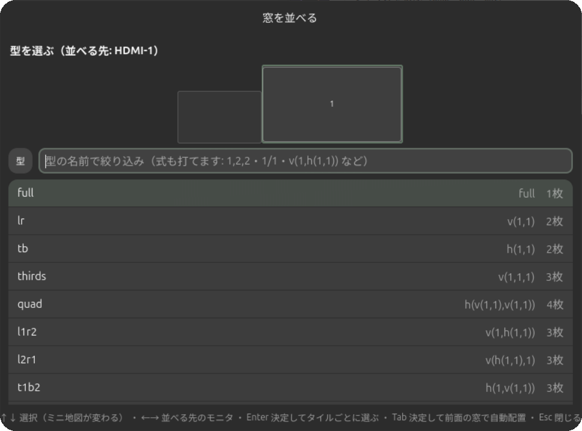
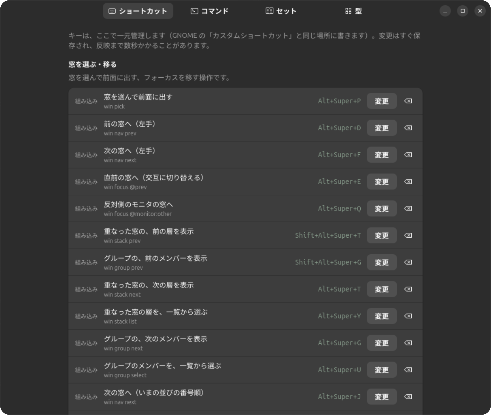

# win

[English](README.md)

GNOME の窓を、コマンドラインから操作する道具です。一覧・前面化・移動・分割配置・重ね・グループ・元に戻す、
そして窓や型をキーボードで選ぶ小窓。Python 製で、GNOME Shell とは D-Bus で話します。

```sh
win list                          # 窓の一覧
win layout lr firefox '!ptyxis'   # 左に Firefox、右に新しい端末
win focus 'firefox?'              # Firefox へ飛ぶ（起動していなければ起動）
win send                          # 前面の窓を、位置と大きさの割合を保って別のモニタへ
win undo                          # 直前の配置の前の状態に戻す
```

**Ubuntu 26.04（GNOME 50.1・Wayland）、2 モニタ、日本語キーボード**でだけ、開発・確認しています。
ほかの GNOME やディストリビューションは未確認です（報告を歓迎します）。画面・メッセージ・`--help` は日本語のみです。

<p align="center">
  
  
</p>

*左: `win layout`（型をキーボードで選ぶ）。右: `win config`。*

## 機能

| コマンド | 内容 |
|---|---|
| `list`・`focus`・`move`・`size`・`max`/`min` など・`close` | 基本の窓操作。窓の指定は、クラス・題名・ID、または `@left`・`@slot:2`・`@monitor:other`・`@group:名前` など。 |
| `layout` | 型の式で分割配置。`full`・`v(a,b,…)`（左右）・`h(a,b,…)`（上下）、割合つき（`v(2:h(1,1),1)`）、`lr`・`quad` などの登録名。引数なしなら小窓で選べます。 |
| `set`・`save` | いま表に出ている窓の並びを、名前をつけて保存し、あとで適用します。 |
| `place`・`here` | 窓を、タイルの上・いちばん広い空き・前面の窓と同じ位置に置きます。 |
| `stack` | 同じ枠に重なった窓を、順に切り替えます。 |
| `group` | 名前つきの窓のグループ。1 つの枠を共有し、タブのように切り替えます。`layout`・`set` の中でも使えます。 |
| `send`・`desktop` | 窓を、割合を保って別のモニタへ。ワークスペースの切り替え（下の補助拡張が要ります）。 |
| `undo` | 直前の操作が動かした窓の、位置・状態・ワークスペース・重なり順を元に戻します。 |
| `pick`・`nav`・`prompt` | キーボードで選ぶ窓の一覧、上下左右のフォーカス移動、補完つきの 1 行コマンド入力。 |
| `config` | ショートカット・コマンド・型・セットの設定の窓。 |
| `shortcuts` | GNOME のカスタムショートカットを TOML で管理: `export`、`apply [--dry-run] [--prune]`。 |
| `stats` | 使用回数の集計（[プライバシー](#プライバシー)）。 |
| 拡張 | 自分のコマンドを Python で書けます（`~/.config/win/ext/`）。API とエディタの補完つき。 |

詳細は `win -h`・`win コマンド -h` を見てください。

## 導入

必要なもの:

- GNOME Shell と、拡張 **[Window Calls](https://extensions.gnome.org/extension/4724/window-calls/)**（入れて、有効にする。これが無いと win は動きません）。
- Python 3.11 以上、PyGObject、GTK 4、libadwaita。Ubuntu なら `sudo apt install python3-gi gir1.2-gtk-4.0 gir1.2-adw-1`。
- 任意: `win desktop` を使うなら、`extension/` の小さな Shell 拡張（`./install.sh --extension`。有効にして、一度ログインし直す）。
- 任意: `firefox`・`ptyxis`・`nvim`（Firefox のタブや端末の作業ディレクトリの保存。設定画面から拡張のソースを開く操作は、`ptyxis` と `nvim` の両方が要ります）。

```sh
git clone https://github.com/dobinnmushi/win.git
cd win
./install.sh               # ~/.local/bin/win へのリンクと、設定画面のランチャーを作る
win list                   # 窓の一覧が出れば導入できています
```

`./uninstall.sh` は、`install.sh` が入れたものを外します（設定には触れません）。
すべて `$HOME` の下に入り、`sudo` は使いません。

## 設定

`~/.config/win/` に置きます。どれも任意です。自分の dotfiles のリポジトリへのリンクにもできます。

| ファイル | 内容 |
|---|---|
| `shortcuts.toml` | GNOME のカスタムショートカット（`win shortcuts apply` で反映）。いまの割り当てから作るには `win shortcuts export ~/.config/win/shortcuts.toml`。 |
| `commands.toml`・`sets.toml` | 登録したコマンドと保存した並び（`win config`・`win save` が書きます）。 |
| `apps.toml` | アプリごとの設定。`[app.名前] new_window = ["--new-window"]` で、引数なしの起動では新しい窓が出ないアプリに、足す引数を指定します。 |
| `ext/` | Python で書いた自分のコマンド。 |

**ショートカット**: win 自身は何も割り当てません。`presets/super-alt.toml` は `Super+Alt+文字` の既成の一式（29 項目）です。
`win shortcuts apply presets/super-alt.toml` で反映するか、欲しい項目を自分の `shortcuts.toml` にコピーしてください。
`--dry-run` で、変わる内容を先に見られます。`apply` はファイルに書いた項目だけを変えます（`--prune` をつけると、
ファイルにない `win-*` の項目も消します）。

## プライバシー

`win stats` は**既定でオン**です。コマンドを実行するたびに、`~/.local/state/win/usage.log` へ 1 行（時刻・コマンド名・
ショートカット経由か手入力か）を追記します。引数は記録せず、外へは何も送りません。`win stats off` で止め、
`win stats reset` で消せます。`win save -s firefox` は、選んだときだけ、タブの URL を平文で `sets.toml` に保存します。

## 既知の制限

- GNOME 50 / Wayland（Ubuntu 26.04）でしか確認していません。補助拡張は GNOME 50 だけを宣言しています。
- `workspaces-only-on-primary` が有効だと、副モニタの窓はすべてのワークスペースに出ていて、ワークスペース間では動かせません。
- 画面のロック中は、GNOME が拡張を止めるので、Window Calls が応答しません。
- アプリの状態の保存は、Firefox（タブ）と Ptyxis（作業ディレクトリ）だけです。

## 開発

```sh
python3 tests/names.py lib/win/win/*.py   # 未定義の名前・未使用のインポート
python3 tests/snapshot.py                 # 純粋な関数を動かして、出力を比べる
python3 tests/helper_test.py              # 補助拡張の D-Bus（gjs が要ります）
```

設計のメモは `docs/` にあります。個人の設定（ショートカット・キーの層・使い方の記録）は、このリポジトリには含めません。

## ライセンス

[MIT](LICENSE)。補助拡張は [Window Calls](https://github.com/ickyicky/window-calls)（GPL-2.0 以降）と D-Bus だけで話し、コードは共有していません。
