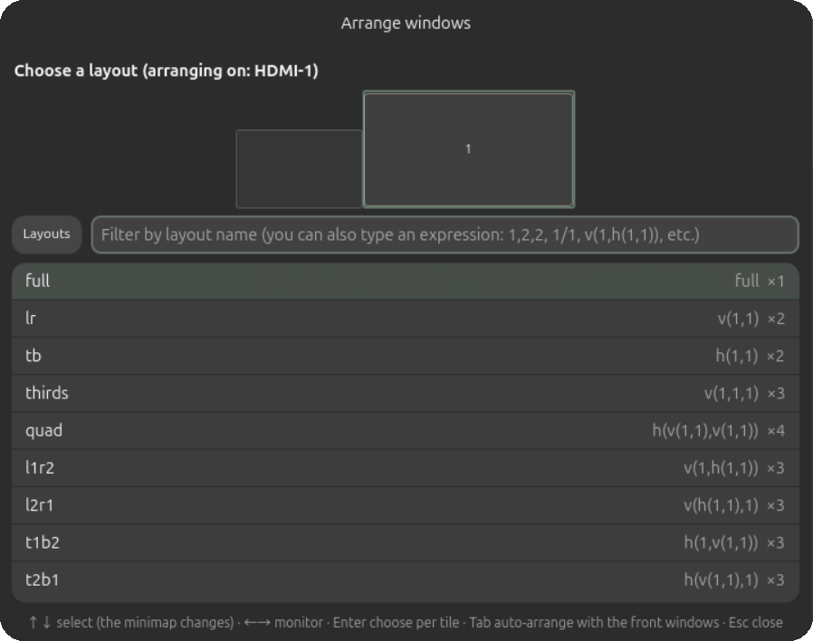
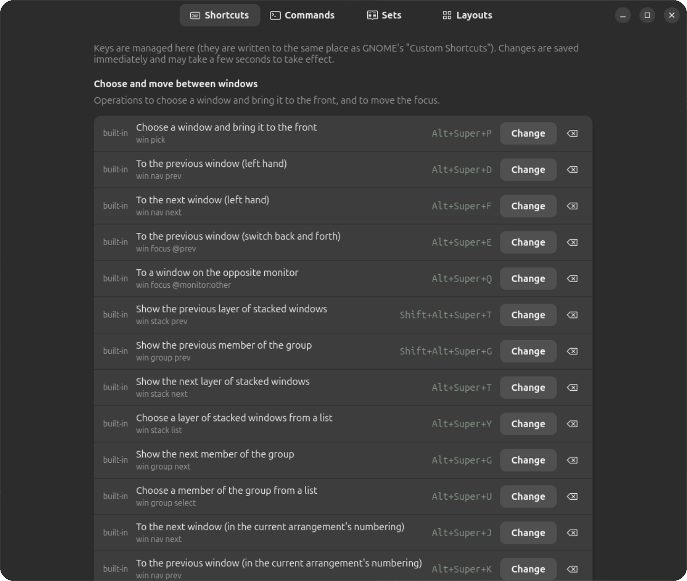

# win

[日本語](README.ja.md)

Control GNOME windows from the command line: list, focus, move, tile, stack, group, undo — plus small
keyboard-driven dialogs for picking windows and layouts. Written in Python; talks to GNOME Shell over D-Bus.

```sh
win list                          # windows
win layout lr firefox '!ptyxis'   # Firefox on the left, a new terminal on the right
win focus 'firefox?'              # jump to Firefox (launch it if it is not running)
win send                          # move the focused window to the other monitor, keeping its proportions
win undo                          # put windows back where they were before the last arrangement
```

Developed and tested only on **Ubuntu 26.04 (GNOME 50.1, Wayland)** with two monitors and a Japanese keyboard.
Other GNOME versions and distributions may work but are untested; reports are welcome.
The interface (dialogs, messages, `--help`) is available in **English and Japanese**. The language follows `LC_ALL`/`LC_MESSAGES`/`LANG`
(Japanese if it starts with `ja`, English otherwise); set `WIN_LANG=ja` or `WIN_LANG=en` to override.

<p align="center">
  
  
</p>

*Left: `win layout` (pick a layout with the keyboard). Right: `win config`.*

## Features

| Command | What it does |
|---|---|
| `list`, `focus`, `move`, `size`, `max`/`min`/…, `close` | Basic window operations. Windows are selected by class, title, ID or specs such as `@left`, `@slot:2`, `@monitor:other`, `@group:name`. |
| `layout` | Tile windows by a layout expression: `full`, `v(a,b,…)` (side by side), `h(a,b,…)` (stacked), with weights (`v(2:h(1,1),1)`); presets such as `lr` and `quad`. Without arguments, a dialog lets you pick. |
| `set`, `save` | Save the windows currently on screen as a named arrangement and apply it later. |
| `place`, `here` | Put a window on top of a tile / in the largest free space / at the same place as the focused window. |
| `stack` | Cycle through windows that share the same frame. |
| `group` | Named groups of windows that share one frame and switch like tabs. Usable inside `layout` and `set`. |
| `send`, `desktop` | Move a window to another monitor keeping its proportions; switch workspaces (needs the helper extension below). |
| `undo` | Restore the position, state, workspace and stacking order of the windows the last operation moved. |
| `pick`, `nav`, `prompt` | Keyboard-driven window picker, directional focus, and a one-line command box with completion. |
| `config` | A settings window for shortcuts, commands, layouts and sets. |
| `shortcuts` | Keep your GNOME custom shortcuts in a TOML file: `export`, `apply [--dry-run] [--prune]`. |
| `stats` | Local usage counts (see [Privacy](#privacy)). |
| Extensions | Write your own commands in Python (`~/.config/win/ext/`), with an API and editor completion. Samples are in `examples/`. |

Run `win -h` and `win COMMAND -h` for details.

## Installation

Requirements:

- GNOME Shell with the extension **[Window Calls](https://extensions.gnome.org/extension/4724/window-calls/)** installed and enabled (win cannot work without it).
- Python 3.11 or newer, PyGObject, GTK 4 and libadwaita. On Ubuntu: `sudo apt install python3-gi gir1.2-gtk-4.0 gir1.2-adw-1`.
- Optional, for `win desktop`: the small Shell extension in `extension/` (`./install.sh --extension`, then enable it and log out and in once).
- Optional: `firefox`, `ptyxis`, `nvim` for the features that use them (saving Firefox tabs and terminal directories; opening an extension's source from the settings window: it uses `$VISUAL` or `$EDITOR` (default `nvim`); a terminal editor is opened in `ptyxis`, while GUI editors such as `code` or `gnome-text-editor` are opened directly. Note that the settings window started from a shortcut does not see variables set only in `~/.bashrc`; put them in `~/.config/environment.d/` instead).

```sh
git clone https://github.com/dobinnmushi/win.git
cd win
./install.sh               # links ~/.local/bin/win and adds a launcher for the settings window
win list                   # should print your windows
```

`./uninstall.sh` removes what `install.sh` added (it does not touch your settings).
Everything is installed under `$HOME`; no `sudo` is used.

## Configuration

Files live in `~/.config/win/` and are all optional. They can be symlinks into your own dotfiles repository.

| File | Content |
|---|---|
| `shortcuts.toml` | GNOME custom shortcuts, applied with `win shortcuts apply`. Create it from your current ones with `win shortcuts export ~/.config/win/shortcuts.toml`. |
| `commands.toml`, `sets.toml` | Registered commands and saved arrangements (written by `win config` and `win save`). |
| `apps.toml` | Per-application settings. `[app.NAME] new_window = ["--new-window"]` adds arguments when launching `NAME` without arguments would not open a new window. |
| `ext/` | Your own commands written in Python. |

**Keyboard shortcuts.** win assigns none by itself. `presets/super-alt.toml` is a ready-made set using
`Super+Alt+letter` (29 entries); apply it with `win shortcuts apply presets/super-alt.toml`, or copy the
entries you want into your own `shortcuts.toml`. `--dry-run` shows what would change; `win shortcuts apply`
only touches the entries listed in the file (plus `--prune`, which removes `win-*` entries not in it).

## Privacy

`win stats` is **on by default**. Each command appends one line to `~/.local/state/win/usage.log`: the time, the
command name, and whether it was started from a keyboard shortcut or typed. Arguments are not recorded, and
nothing leaves your machine. `win stats off` turns it off, `win stats reset` deletes the log.
`win save -s firefox` stores your tabs' URLs in plain text in `sets.toml`, only when you ask for it.

## Known limitations

- Only tested on GNOME 50 / Wayland, Ubuntu 26.04. The helper extension declares GNOME 50 only.
- With `workspaces-only-on-primary` enabled, windows on secondary monitors appear on every workspace and cannot be moved between them.
- While the screen is locked, GNOME disables extensions and Window Calls does not respond.
- Saving application state works for Firefox (tabs) and Ptyxis (working directories) only.
- Not translated: the nvim input box of `win prompt --nvim` (experimental). Text you write yourself (your extensions' docstrings, set names) stays as written.

## Development

```sh
python3 tests/names.py lib/win/win/*.py   # undefined names and unused imports
python3 tests/snapshot.py                 # runs pure functions and compares their output
python3 tests/helper_test.py              # helper extension's D-Bus (needs gjs)
python3 tests/i18n_check.py               # every tr("…") string has an English entry, with matching {placeholders}
```

Interface strings are written in Japanese inside `tr("…")`; the English translations are in `lib/win/win/i18n_en.py`
(add an entry there when you add a string). Design notes are in `docs/en/` (translated from the Japanese originals in `docs/`). Personal settings (shortcuts, key layers, usage notes) are intentionally not part of this
repository.

## License

[MIT](LICENSE). The helper extension talks to [Window Calls](https://github.com/ickyicky/window-calls) (GPL-2.0-or-later) over D-Bus only; no code is shared.
